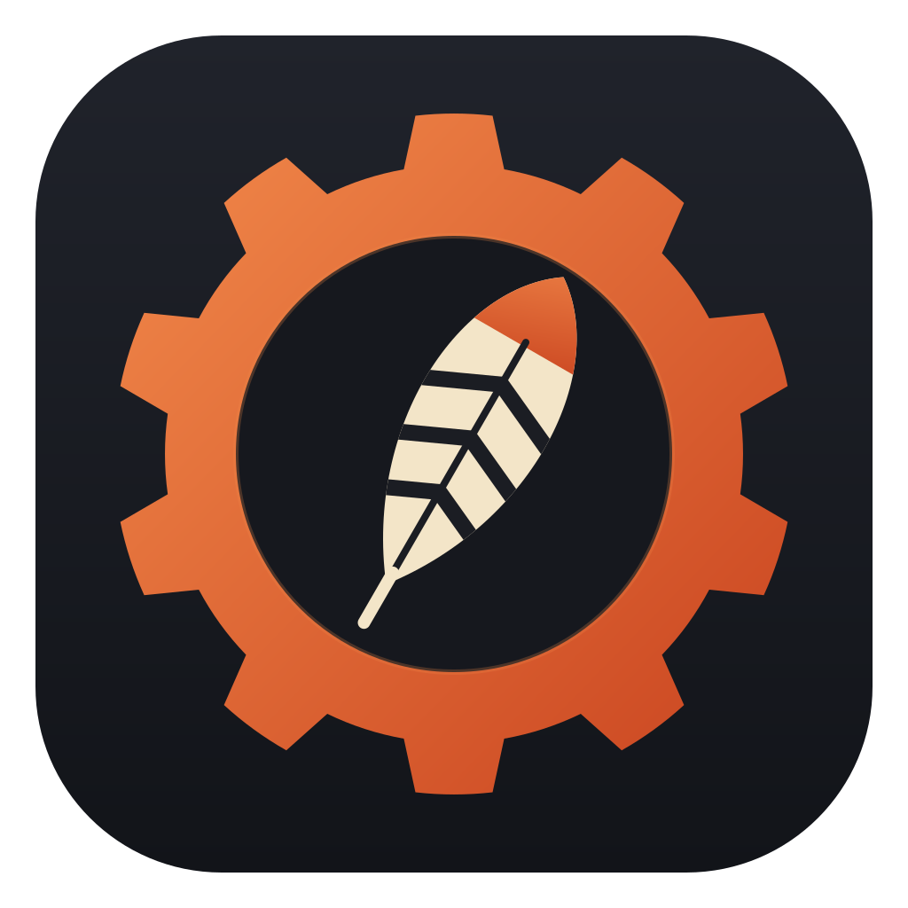

<p align="center">
  
</p>

<h1 align="center">Gerenciador de Projetos</h1>

<p align="center">
  Um "Docker Desktop" para os seus projetos locais: lista, roda, para e abre no navegador — tudo pela interface.
</p>

---

## O que é

Um app desktop para Windows que encontra os projetos que você tem no disco, descobre sozinho como rodar cada um
(Node, Docker, Python, PHP) e deixa você iniciar/parar com um clique, ver os logs, a porta em que subiu e abrir
direto no navegador.

Os projetos são agrupados em **famílias** — uma família é simplesmente uma pasta (ex.: `Trabalho`, `Estudos`) e cada
subpasta dela vira um projeto na barra lateral, no estilo pastas + sessões do Claude Code.

### Funcionalidades

- **Famílias de projetos**: adicione uma pasta e todos os projetos dentro dela aparecem na barra lateral.
- **Detecção automática** do comando de inicialização (ver [Como os projetos são detectados](#como-os-projetos-são-detectados)).
- **Sub-projetos**: se uma pasta não tem marcador na raiz mas tem projetos um nível abaixo (ex.: `front/` + `back/`),
  cada um vira um sub-projeto com iniciar/parar próprio — ou "Iniciar todos" de uma vez.
- **Comandos personalizados**: sobrescreva os comandos detectados (vários por projeto, cada um em um processo
  separado, com pasta e comando de parada opcionais) e defina uma URL fixa.
- **Porta e "Abrir no navegador"**: a porta é lida do log (`http://localhost:5173`, `listening on port 3000`, etc.).
- **Logs em tempo real** por comando, com auto-scroll.
- **Ocultar projetos/sub-projetos** que você não usa (o olho no topo da barra lateral mostra os ocultos).
- **Bandeja do sistema**: fechar a janela mantém o app rodando na bandeja; "Sair" no menu da bandeja encerra o
  app **e todos os processos iniciados por ele** (nada fica órfão).
- **Instância única**: abrir o app de novo só traz de volta a janela que já está rodando.
- **Status** em cada item: 🟢 rodando · 🔴 terminou com erro · ⚪ parado.

## Estrutura de diretórios esperada

O app não exige uma pasta específica — você escolhe quais pastas são famílias pelo botão **+**. A regra é:

```
Projetos/                          ← (opcional) pasta raiz onde ficam as famílias
├── Trabalho/                      ← FAMÍLIA  (adicionada pelo botão +)
│   ├── minha-loja/                ← PROJETO sem marcador na raiz → procura um nível abaixo
│   │   ├── frontend/              ←   sub-projeto (package.json com script "dev")
│   │   └── backend/               ←   sub-projeto (package.json)
│   ├── servicos/                  ← PROJETO (docker-compose.yml)
│   └── docs/                      ← aparece como "unknown" → configure ou oculte
└── Estudos/                       ← outra FAMÍLIA
    ├── app-react/                 ← PROJETO (package.json)
    ├── api-python/                ← PROJETO (main.py)
    └── site-php/                  ← PROJETO (composer.json + public/)
```

- **Família** = qualquer pasta que você adicionar.
- **Projeto** = cada subpasta imediata da família (pastas que começam com `.` e `node_modules` são ignoradas).
- **Sub-projeto** = quando o projeto não tem marcador na raiz, cada subpasta dele que tiver um marcador.

### Como os projetos são detectados

Para cada pasta, vale a **primeira** regra que casar:

| Marcador na pasta | Tipo | Comando |
|---|---|---|
| `docker-compose.yml` / `docker-compose.yaml` / `compose.yml` / `compose.yaml` | docker | `docker compose up` (para com `docker compose stop`) |
| `package.json` com script `dev` (ou `start`) | node | `npm run dev` — ou `pnpm`/`yarn`/`bun` conforme o lockfile |
| `artisan` | php | `php artisan serve` |
| `composer.json` ou `index.php` | php | `php -S localhost:8000` (com `-t public` se existir `public/`) |
| `manage.py` | python | `python manage.py runserver` |
| `main.py` ou `app.py` | python | `python main.py` / `python app.py` |

Em projetos Python, se existir `.venv\Scripts\python.exe` ou `venv\Scripts\python.exe`, ele é usado no lugar do
`python` global.

Se nada for detectado (ou o detectado não servir), clique em **Configurar** no projeto e defina os comandos à mão.
A configuração fica salva por projeto e pode ser desfeita com "Restaurar detecção automática".

## Como rodar

### Pré-requisitos (Windows 10/11)

| Ferramenta | Versão | Observação |
|---|---|---|
| [Rust](https://rustup.rs/) | stable, toolchain `x86_64-pc-windows-msvc` | |
| [Node.js](https://nodejs.org/) | 22.18+ (recomendado 24) | o teste do frontend usa TypeScript nativo do Node |
| Visual Studio 2022 Build Tools | workload **"Desktop development with C++"** | inclui o MSVC e o Windows SDK — sem isso o Rust não linka |
| WebView2 | — | já vem no Windows 11 |

Instalando o Build Tools pelo winget (pede permissão de administrador):

```powershell
winget install --id Microsoft.VisualStudio.2022.BuildTools --override "--passive --wait --add Microsoft.VisualStudio.Workload.VCTools --includeRecommended"
```

Para os projetos que você vai gerenciar, o que eles precisarem precisa estar no `PATH`
(`node`/`npm`, `docker`, `python`, `php`...).

### Desenvolvimento

```powershell
git clone https://github.com/vfdutra/project_manager.git
cd project_manager
npm install
npm run tauri dev
```

A primeira compilação do Rust demora alguns minutos.

### Gerar o instalador

```powershell
npm run tauri build
```

O executável e os instaladores (`.msi` e `.exe`) ficam em `src-tauri/target/release/bundle/`.

### Testes

```powershell
cargo test --manifest-path src-tauri/Cargo.toml   # detecção, portas, config, processos
npm test                                          # estado da UI (node --test)
npm run build                                     # type-check + build do frontend
```

## Primeiro uso

1. Abra o app e clique em **+** no topo da barra lateral.
2. Escolha a pasta de uma família (ex.: `C:\Users\voce\Documents\Projetos\Trabalho`).
3. Clique num projeto → ▶ para iniciar. Os logs aparecem na aba do comando e a porta aparece assim que o servidor
   anunciar a URL.
4. Use **Abrir no navegador**, ■ para parar, **Configurar** para ajustar comandos.

## Tecnologias

- **[Tauri 2](https://tauri.app/)** — app desktop com backend em **Rust** e UI em webview (WebView2).
  Plugins: `tauri-plugin-dialog` (escolher pasta) e `tauri-plugin-opener` (abrir URL); recurso `tray-icon`.
- **Rust** — detecção de projetos, configuração (JSON via `serde`), gerenciamento de processos
  (`cmd /C`, `taskkill /T`), leitura de porta nos logs (`regex`).
- **React 19 + TypeScript + Vite** — interface; sem biblioteca de componentes, CSS puro em tema escuro e ícones SVG inline.
- Testes: `cargo test` (+ `tempfile`) no backend e `node --test` no frontend.

## Estrutura do código

```
src-tauri/src/
├── detect.rs     detecção do tipo de projeto e do comando
├── ports.rs      extrai a URL/porta das linhas de log
├── config.rs     famílias, overrides e itens ocultos (config.json)
├── runner.rs     inicia/para processos e transmite logs como eventos
└── lib.rs        comandos Tauri, bandeja e encerramento limpo
src/
├── api.ts             tipos + chamadas ao backend
├── runtime.ts         estado de execução (reducer puro, testado em tests/)
├── useRuntime.ts      liga os eventos do backend ao estado
├── Sidebar.tsx        famílias → projetos → sub-projetos
├── ProjectPanel.tsx   ações, porta, abas de log
├── CommandEditor.tsx  edição de comandos
└── icons.tsx          ícones SVG
```

## Configuração e dados

Tudo fica em `%APPDATA%\com.vfdutra.projectmanager\config.json`: famílias, comandos personalizados, URLs fixas e
itens ocultos. Se o arquivo corromper, ele é renomeado para `config.json.bak` e o app começa do zero (nada é
sobrescrito em silêncio).

## Limitações conhecidas

- **Somente Windows** (usa `cmd`, `taskkill` e APIs do Windows para os processos).
- A porta é descoberta **pelo log**: servidores que não imprimem a URL (comum no `docker compose`) precisam de uma
  URL fixa em **Configurar**.
- Não há terminal interativo (stdin) para os processos.

## Ícone

O ícone (`app-icon.svg`) é uma engrenagem em cor de **urucum** com uma pena pintada com grafismo em **jenipapo** —
referências a pigmentos e grafismos usados por povos indígenas brasileiros. Para regenerar os tamanhos após
editar o SVG:

```powershell
npx tauri icon app-icon.svg
cargo clean -p project-manager --manifest-path src-tauri/Cargo.toml   # o ícone fica embutido no .exe
```
